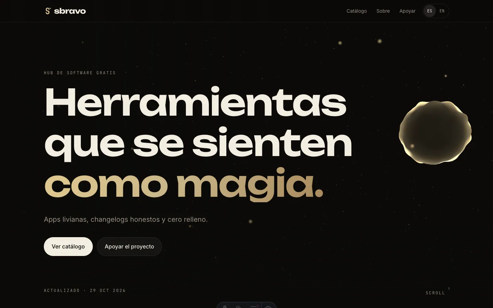
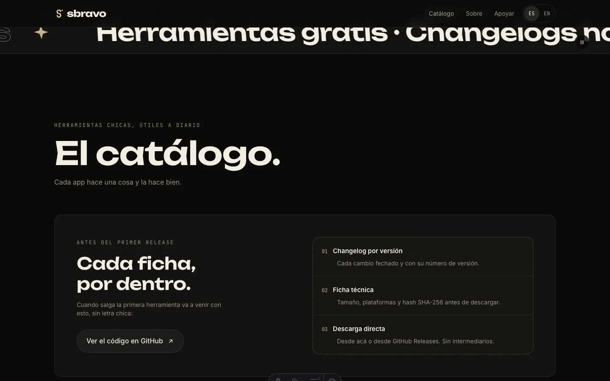
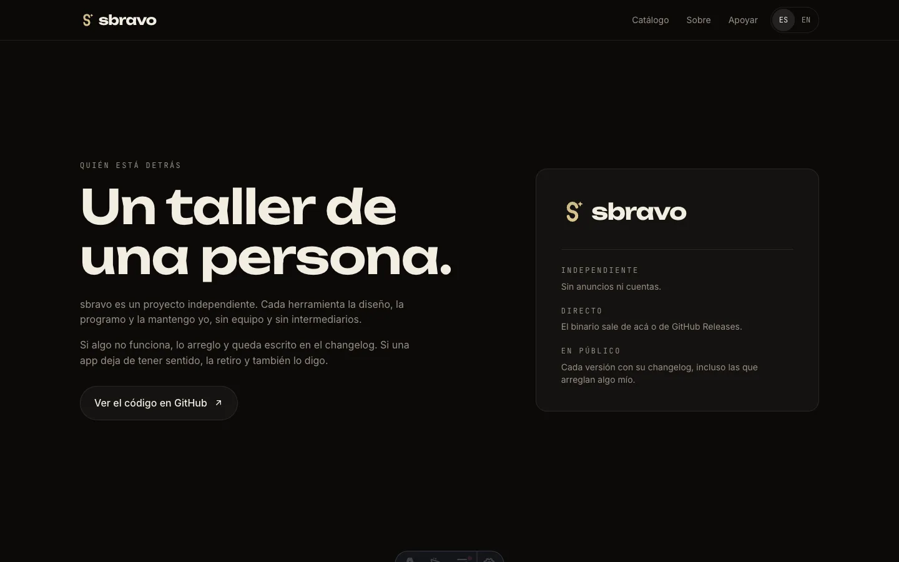
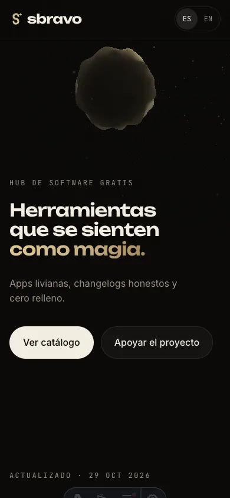

# sbravo

Sitio de [sbravo.app](https://sbravo.app): el catálogo de herramientas gratuitas que
construyo y mantengo yo. Cada app tiene su ficha con versión, plataformas, tamaño,
hash SHA-256, changelog por release y descarga directa.

Es un sitio estático, bilingüe (español en `/`, inglés en `/en/`) y sin analítica,
cookies ni scripts de terceros. El movimiento respeta `prefers-reduced-motion` y el
hero cae a un degradado estático cuando no hay WebGL.

## Capturas

| Portada | Catálogo |
|---|---|
|  |  |

| Sobre el autor | Vista móvil |
|---|---|
|  |  |
