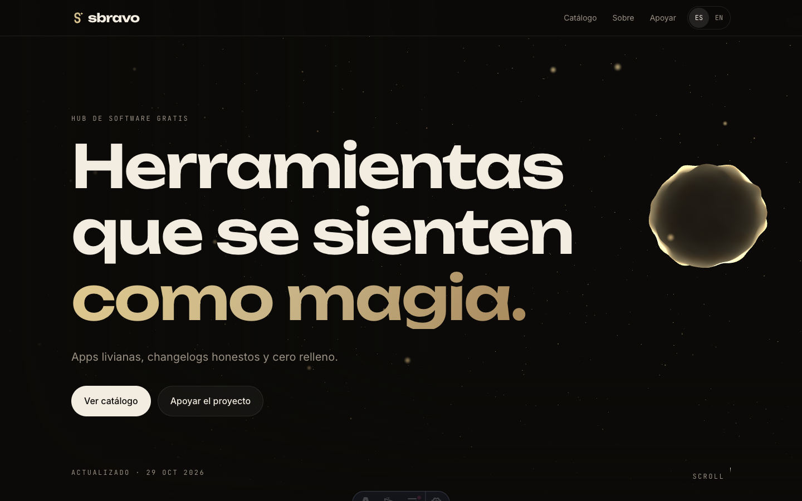
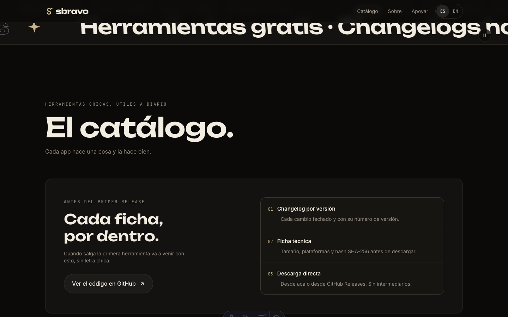
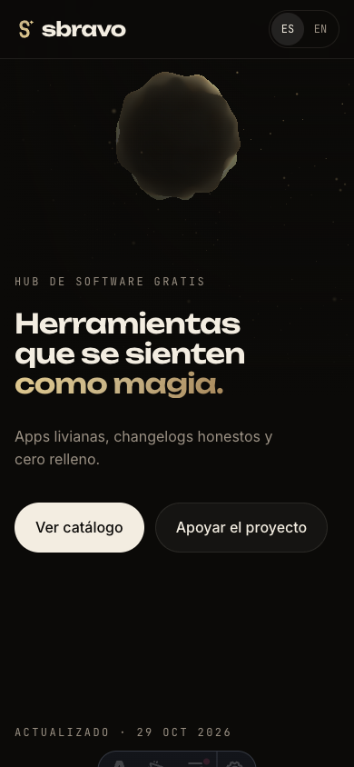

# sbravo

Sitio de [sbravo.app](https://sbravo.app): el catálogo de herramientas gratuitas que
construyo y mantengo yo. Cada app tiene su ficha con versión, plataformas, tamaño,
hash SHA-256, changelog por release y descarga directa.

Es un sitio estático, bilingüe (español en `/`, inglés en `/en/`) y sin analítica,
cookies ni scripts de terceros. El movimiento respeta `prefers-reduced-motion` y el
hero cae a un degradado estático cuando no hay WebGL.

## Capturas

## Stack

- [Astro](https://astro.build) 7 — salida estática y ruteo i18n integrado
- [Tailwind CSS](https://tailwindcss.com) 4 — tokens de diseño en `src/styles/global.css`
- [three.js](https://threejs.org) 0.186 — escena del hero, cargada en un chunk aparte
- [GSAP](https://gsap.com) y [Lenis](https://lenis.darkroom.engineering) — animación ligada al scroll
- [Vitest](https://vitest.dev) — tests de catálogo, i18n y feed RSS
- TypeScript en modo estricto sobre todo el proyecto
